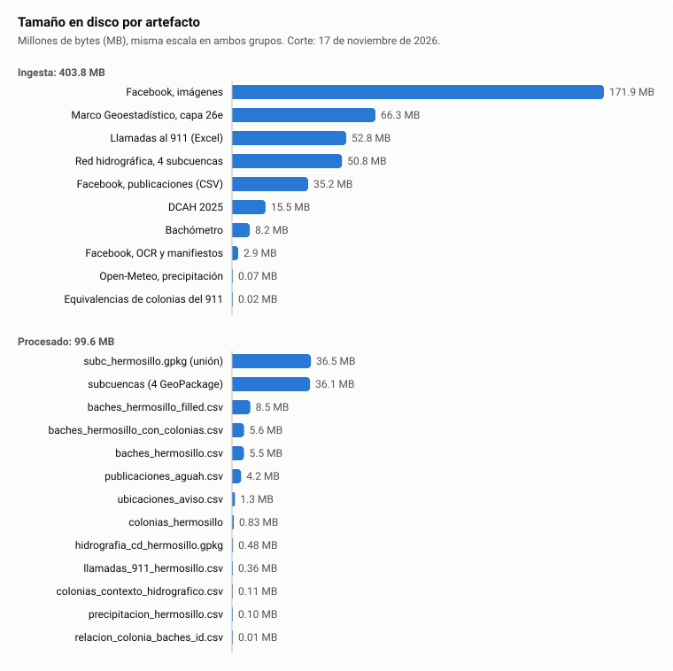
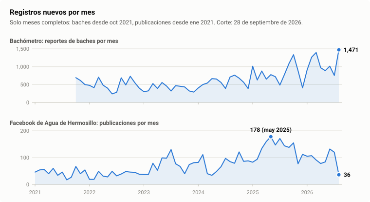

# Las cinco V de los datos del proyecto

Corte: 17 de noviembre de 2026, commit `84e9697`. Los procesados vienen de tres corridas
(hora de Hermosillo): baches del 28/09/2026; Agua de Hermosillo, colonias y baches con
colonia intermedios del 03/10/2026; precipitación, llamadas al 911, subcuencas, contextos
y baches con colonia del 15 y 16/11/2026.

## Fuentes de ingesta

- Bachómetro Hermosillo (`data/raw/bachometro/`): baches atendidos, de la API
  `https://bachometro.hermosillo.gob.mx/mapa/ajax`. 6 JSON, uno por año de 2021 a 2026;
  8.2 MB; 39,106 registros del 17/09/2021 al 03/10/2026. La fecha es la de atención del
  bache, no la de su aparición.
- INEGI, Delimitación de colonias y otros asentamientos humanos (DCAH) 2025
  (`data/raw/inegi/dcah/`): ZIP de Sonora bajado por rango del paquete nacional, con el
  shapefile `26as`, el catálogo de asentamientos y los metadatos; 15.5 MB; 2,699
  asentamientos.
- INEGI, Marco Geoestadístico 2025, capa `26e` (`data/raw/inegi/mg/`): ejes de vialidad de
  Sonora; shapefile y metadato bajados por rango del paquete estatal; 66.3 MB; 229,303
  tramos de calle.
- INEGI, Red hidrográfica 1:50 000, edición 2.0 (`data/raw/inegi/subc_*/`): subcuencas La
  Poza, R. Sonora - Hermosillo, La Manga y R. San Miguel; un ZIP por subcuenca con 5 capas
  (`hl`, `dr`, `ha`, `subc`, `to`); 50.8 MB; 48,023 geometrías.
- Llamadas al 911 por colonia, Hermosillo 2018 a 2025 (`data/raw/llamadas911/`): Excel
  publicado en Hugging Face (Marcelinux, CC-BY-4.0); 1 archivo con 8 hojas, una por año;
  52.8 MB; 2,297,081 llamadas con colonia en texto libre, tipo de incidente (475
  categorías), fecha y hora.
- Open-Meteo, API de archivo histórico (`data/raw/precipitacion/`): precipitación diaria y
  horas con lluvia en un punto de la ciudad, del 01/01/2018 al 30/09/2026; 1 JSON; 0.07 MB;
  3,195 días. Estimación de modelo de reanálisis, no estación.
- Facebook de Agua de Hermosillo (`data/external/`, sin `FUENTE.txt`, documentado en
  `data/SNAPSHOT.md`): 7 CSV del scraper Apify con 5,200 publicaciones del 07/12/2020 al
  14/09/2026 (35.2 MB), 3,203 imágenes (171.9 MB) y su texto extraído con PaddleOCR-VL 1.6
  (7 CSV). Snapshot congelado.
- Equivalencias de colonias del 911 (`data/external/equivalencias_colonias_911.csv`,
  documentado en `data/SNAPSHOT.md`): 294 nombres de colonia del 911 sin match exacto, con
  hasta 3 sugerencias del catálogo; 144 con la equivalencia confirmada a mano en la
  columna `OK`; 0.02 MB.

## Datos tidy procesados

- `data/processed/bachometro/baches_hermosillo.csv`: una fila por bache atendido;
  39,018 × 10; 5.5 MB. Fuente: Bachómetro. Diccionario: `references/baches.csv`.
- `data/processed/bachometro/baches_hermosillo_filled.csv`: los mismos 39,018 baches con
  la colonia del DCAH asignada por ubicación; 39,018 × 16; 8.5 MB. Intermedios:
  `relacion_colonia_baches_id.csv` (789 × 4) y `baches_hermosillo_con_colonias.csv`
  (39,018 × 11). Diccionario: `references/baches_con_colonia.csv`.
- `data/processed/llamadas_911/llamadas_911_hermosillo.csv`: una fila por llamada de los
  28 tipos de incidente ligados al agua y al terreno, con `colonia_id` del DCAH;
  4,176 × 7; 0.36 MB. Fuentes: 911, colonias y equivalencias. Diccionario:
  `references/llamadas_911_hermosillo.csv`.
- `data/processed/precipitacion/precipitacion_hermosillo.csv`: una fila por día;
  3,195 × 6; 0.10 MB. Fuente: Open-Meteo. Diccionario:
  `references/precipitacion_hermosillo.csv`.
- `data/processed/aguah/publicaciones_aguah.csv`: una fila por publicación, con texto,
  OCR, reacciones y variables derivadas; 5,200 × 32; 4.2 MB. Fuente: Facebook.
  Diccionario: `references/publicaciones_aguah.csv`.
- `data/processed/aguah/colonias_hermosillo.csv` y `.gpkg`: una fila por asentamiento del
  municipio de Hermosillo; 783 × 10, más el polígono en el GeoPackage; 0.83 MB; 762 de la
  ciudad (localidad 0001). Fuente: DCAH. Diccionario: `references/colonias_hermosillo.csv`.
- `data/processed/aguah/ubicaciones_aviso.csv`: una fila por lugar mencionado en una
  publicación; 16,261 × 8; 1.3 MB. Fuentes: publicaciones, colonias y calles del Marco
  Geoestadístico. Diccionario: `references/ubicaciones_aviso.csv`.
- `data/processed/inegi/subc_*/subc_*.gpkg`: un GeoPackage por subcuenca con 5 capas;
  47,426 geometrías; 36.1 MB. Fuente: Red hidrográfica. Diccionarios:
  `references/subc_*.csv`.
- `data/processed/inegi/hidrografia_hermosillo/subc_hermosillo.gpkg`: las 4 subcuencas
  unidas en un GeoPackage de 5 capas; 47,426 geometrías; 36.5 MB.
- `data/processed/inegi/hidrografia_hermosillo/hidrografia_cd_hermosillo.gpkg`: las 5
  capas recortadas a las 762 colonias de la ciudad; 463 geometrías (437 tramos de cauce);
  0.48 MB.
- `data/processed/inegi/hidrografia_hermosillo/colonias_contexto_hidrografico.csv`: una
  fila por colonia de la ciudad con sus 3 tramos de cauce más cercanos y su contexto
  hidrográfico; 762 × 15; 0.11 MB. Fuentes: colonias y red hidrográfica. Diccionario:
  `references/colonias_contexto_hidrografico.csv`.

## Volumen

`scripts/figura_volumen.py` redibuja la gráfica con los tamaños de `data/`.

| Etapa | Artefacto | Tamaño | Archivos | Registros | Columnas |
|---|---|---:|---:|---|---|
| Ingesta | Bachómetro | 8.2 MB | 6 | 39,106 baches atendidos | 7 |
| Ingesta | DCAH 2025 | 15.5 MB | 1 | 2,699 asentamientos | 10 |
| Ingesta | Marco Geoestadístico, capa `26e` | 66.3 MB | 6 | 229,303 tramos | 11 |
| Ingesta | Red hidrográfica, 4 subcuencas | 50.8 MB | 4 | 48,023 geometrías | 3 a 22 por capa |
| Ingesta | Llamadas al 911 | 52.8 MB | 1 (8 hojas) | 2,297,081 llamadas | 4 |
| Ingesta | Open-Meteo, precipitación | 0.07 MB | 1 | 3,195 días | 3 |
| Ingesta | Facebook, publicaciones | 35.2 MB | 7 | 5,200 publicaciones | 936 a 2,000 por archivo; 2,709 distintas, 1,984 siempre vacías |
| Ingesta | Facebook, imágenes | 171.9 MB | 3,203 | 3,203 imágenes | no aplica |
| Ingesta | Facebook, OCR y manifiestos | 2.9 MB | 21 | 5,200 filas de OCR | 4 |
| Ingesta | Equivalencias de colonias del 911 | 0.02 MB | 1 | 294 nombres | 6 |
| Intermedio | `data/interim/`, ZIP del INEGI extraídos | 118.7 MB | 122 | | |
| Procesado | `baches_hermosillo.csv` | 5.5 MB | 1 | 39,018 | 10 |
| Procesado | `relacion_colonia_baches_id.csv` | 0.01 MB | 1 | 789 | 4 |
| Procesado | `baches_hermosillo_con_colonias.csv` | 5.6 MB | 1 | 39,018 | 11 |
| Procesado | `baches_hermosillo_filled.csv` | 8.5 MB | 1 | 39,018 | 16 |
| Procesado | `llamadas_911_hermosillo.csv` | 0.36 MB | 1 | 4,176 | 7 |
| Procesado | `precipitacion_hermosillo.csv` | 0.10 MB | 1 | 3,195 | 6 |
| Procesado | `publicaciones_aguah.csv` | 4.2 MB | 1 | 5,200 | 32 |
| Procesado | `colonias_hermosillo` (CSV y GeoPackage) | 0.83 MB | 2 | 783 | 10, más el polígono |
| Procesado | `ubicaciones_aviso.csv` | 1.3 MB | 1 | 16,261 | 8 |
| Procesado | `subc_*.gpkg` | 36.1 MB | 4 | 47,426 geometrías | 2 a 6 por capa |
| Procesado | `subc_hermosillo.gpkg` | 36.5 MB | 1 | 47,426 geometrías | 2 a 8 por capa |
| Procesado | `hidrografia_cd_hermosillo.gpkg` | 0.48 MB | 1 | 463 geometrías | 2 a 8 por capa |
| Procesado | `colonias_contexto_hidrografico.csv` | 0.11 MB | 1 | 762 | 15 |
| Total | Ingesta | 403.8 MB | 3,251 | | |
| Total | Procesado | 99.6 MB | 17 | | |

## Velocidad

| Etapa | Artefacto | Periodo | Ritmo de la fuente | Cómo se actualiza | Última actualización |
|---|---|---|---|---|---|
| Ingesta | Bachómetro | 17/09/2021 a 03/10/2026 | continuo: 16.1 baches atendidos al día en 2022, 36.1 en 2026 | `make download` vuelve a bajar el año en curso y omite los anteriores | 03/10/2026 16:36 UTC |
| Ingesta | DCAH 2025 | edición 2025 | anual | descarga única; se omite si ya existe | datos a 11/2025 (21 asentamientos a 11/2022); descarga del 25/09/2026 |
| Ingesta | Marco Geoestadístico | edición 2025 | anual | descarga única | descarga del 25/09/2026 |
| Ingesta | Red hidrográfica | edición 2.0 | sin actualización | descarga única | segmentos fechados de 1998 a 2010; descarga del 26/09/2026 |
| Ingesta | Llamadas al 911 | 01/01/2018 a 30/09/2025 | archivo publicado una vez | descarga única; se omite si ya existe | 16/11/2026 02:07 UTC |
| Ingesta | Open-Meteo, precipitación | 01/01/2018 a 30/09/2026 | diario | descarga única con rango fijo en `params.yml`; se omite si ya existe | 16/11/2026 02:09 UTC |
| Ingesta | Facebook | 07/12/2020 a 14/09/2026 | continuo: mediana de 15 publicaciones por semana | extracción única: scraper de paga, imágenes con URL que expira, OCR en GPU (5.9 s por imagen) | snapshot v1, 17/09/2026 |
| Ingesta | Equivalencias de colonias del 911 | no aplica | revisión manual | snapshot en SharePoint | 16/11/2026 |
| Procesado | `baches_hermosillo.csv` | 17/09/2021 a 28/09/2026 | | `make data`, recalculado completo: 0.25 s | 28/09/2026 21:01 |
| Procesado | `baches_hermosillo_filled.csv` | igual que `baches_hermosillo.csv` | | `make data` | 16/11/2026 20:04 |
| Procesado | `llamadas_911_hermosillo.csv` | 05/01/2018 a 30/09/2025 | | `make data`: 8.3 s de lectura del Excel y 0.02 s de asignación de colonia | 16/11/2026 20:03 |
| Procesado | `precipitacion_hermosillo.csv` | igual que su fuente | | `make data`: 0.007 s | 15/11/2026 19:09 |
| Procesado | `publicaciones_aguah.csv` | igual que su fuente | | `make data`: 0.41 s | 03/10/2026 09:36 |
| Procesado | `colonias_hermosillo` | igual que su fuente | | `make data`: 0.63 s | 03/10/2026 09:36 |
| Procesado | `ubicaciones_aviso.csv` | igual que Facebook | | `make data`: 19.46 s | 03/10/2026 09:36 |
| Procesado | `subc_*.gpkg`, `subc_hermosillo.gpkg` y `hidrografia_cd_hermosillo.gpkg` | igual que su fuente | | `make data` | 16/11/2026 20:03 |
| Procesado | `colonias_contexto_hidrografico.csv` | estático | | `make data`: 0.95 s | 16/11/2026 20:09 |
| Procesado | `references/*.csv` | | | `make dictionary`, fuera de `make data` | baches: 17/11/2026; 911, precipitación y contexto: 16/11/2026; los demás: 26/09/2026 |

Datos del gráfico de velocidad y llamadas por año

Baches atendidos por mes (`*` mes incompleto, fuera del gráfico).

| Año | ene | feb | mar | abr | may | jun | jul | ago | sep | oct | nov | dic |
|---|---:|---:|---:|---:|---:|---:|---:|---:|---:|---:|---:|---:|
| 2021 |  |  |  |  |  |  |  |  | 226* | 693 | 615 | 500 |
| 2022 | 479 | 413 | 706 | 484 | 400 | 240 | 283 | 688 | 489 | 732 | 553 | 398 |
| 2023 | 301 | 324 | 528 | 391 | 558 | 459 | 320 | 469 | 453 | 434 | 322 | 290 |
| 2024 | 406 | 501 | 543 | 665 | 656 | 560 | 391 | 710 | 764 | 680 | 565 | 389 |
| 2025 | 1,013 | 629 | 878 | 652 | 777 | 720 | 487 | 778 | 1,088 | 1,335 | 888 | 408 |
| 2026 | 909 | 1,265 | 1,397 | 970 | 889 | 1,015 | 755 | 1,471 | 1,116* |  |  |  |

Publicaciones de Agua de Hermosillo por mes (`*` mes incompleto, fuera del gráfico).

| Año | ene | feb | mar | abr | may | jun | jul | ago | sep | oct | nov | dic |
|---|---:|---:|---:|---:|---:|---:|---:|---:|---:|---:|---:|---:|
| 2020 |  |  |  |  |  |  |  |  |  |  |  | 45* |
| 2021 | 46 | 54 | 56 | 40 | 60 | 34 | 46 | 17 | 27 | 67 | 40 | 54 |
| 2022 | 19 | 19 | 49 | 31 | 28 | 49 | 32 | 39 | 48 | 46 | 45 | 38 |
| 2023 | 37 | 37 | 79 | 53 | 99 | 98 | 130 | 77 | 67 | 40 | 74 | 81 |
| 2024 | 82 | 111 | 40 | 34 | 48 | 66 | 97 | 85 | 79 | 121 | 86 | 88 |
| 2025 | 83 | 94 | 134 | 160 | 178 | 147 | 171 | 144 | 138 | 155 | 77 | 112 |
| 2026 | 105 | 107 | 91 | 78 | 84 | 132 | 120 | 36 | 16* |  |  |  |

Llamadas al 911 seleccionadas por año (`llamadas_911_hermosillo.csv`).

| 2018 | 2019 | 2020 | 2021 | 2022 | 2023 | 2024 | 2025 |
|---:|---:|---:|---:|---:|---:|---:|---:|
| 504 | 425 | 231 | 571 | 825 | 445 | 538 | 637 |

## Variedad

| Etapa | Artefacto | Formato | Estructura | Geometría y CRS | Codificación | Tipos de columna |
|---|---|---|---|---|---|---|
| Ingesta | Bachómetro | JSON | lista de objetos; `neighborhoods` es una lista anidada | puntos como texto (lat, lon), sin CRS declarado | UTF-8 | 4 texto, 2 entero, 1 lista |
| Ingesta | DCAH 2025 | shapefile, CSV, TXT, XML y PDF | atributos y geometría; catálogo nacional aparte | polígonos, EPSG:6372 | UTF-8; metadatos en ISO-8859-1 | 10 texto |
| Ingesta | Marco Geoestadístico | shapefile y TXT | atributos y geometría | líneas, EPSG:6372 con un `.prj` sin código EPSG | ISO-8859-1 | 10 texto, 1 entero |
| Ingesta | Red hidrográfica | shapefile (5 capas), PDF y JPG | atributos y geometría | líneas, puntos y polígonos, EPSG:4019 | ISO-8859-1 | 72 atributos en 5 capas |
| Ingesta | Llamadas al 911 | Excel (XLSX), una hoja por año | tabla plana; colonia y tipo de incidente en texto libre | sin geometría; la ubicación es el nombre de colonia capturado por el operador | UTF-8 | 2 texto, 1 fecha, 1 hora |
| Ingesta | Open-Meteo, precipitación | JSON | objeto con arreglos paralelos en `daily` (`time`, `precipitation_sum`, `precipitation_hours`) | un punto: se pidió 29.0892, -110.9613 y la API responde con la celda 29.0685, -110.9759 | UTF-8 | 1 fecha, 2 decimal |
| Ingesta | Facebook | CSV, JPG, PNG, WEBP y CSV de OCR | JSON aplanado en columnas; texto libre; imágenes | sin geometría | UTF-8 | de las 725 columnas con datos: 422 texto, 145 numéricas, 158 booleanas |
| Ingesta | Equivalencias de colonias del 911 | CSV | una fila por nombre del 911 | sin geometría | UTF-8 | 5 texto, 1 entero |
| Procesado | `baches_hermosillo.csv` | CSV | tidy; `neighborhoods` como texto de lista (`"[551]"`) | lat y lon numéricos, WGS84 implícito | UTF-8 | 4 entero, 2 decimal, 1 fecha, 3 texto |
| Procesado | `baches_hermosillo_filled.csv` | CSV | tidy; una fila por bache con su colonia | lat y lon numéricos, WGS84 implícito; distancia a la colonia en metros | UTF-8 | 4 entero, 4 decimal, 2 fecha, 6 texto |
| Procesado | `llamadas_911_hermosillo.csv` | CSV | tidy; tipo y grupo de incidente como catálogos cerrados | sin geometría; `colonia_id` de 13 dígitos | UTF-8 | 5 texto (incluida `colonia_id`), 1 fecha, 1 entero |
| Procesado | `precipitacion_hermosillo.csv` | CSV | tidy; una fila por día | sin geometría | UTF-8 | 1 fecha, 2 decimal, 2 entero, 1 booleano |
| Procesado | `publicaciones_aguah.csv` | CSV | tidy; 3 columnas de texto libre | sin geometría | UTF-8 | 18 entero, 6 texto, 4 booleano, 2 fecha, 2 decimal |
| Procesado | `colonias_hermosillo` | CSV y GeoPackage | tidy | centroides y polígonos, EPSG:4326 | UTF-8 | 7 texto, 3 decimal |
| Procesado | `ubicaciones_aviso.csv` | CSV | tidy; 3 catálogos cerrados | puntos, EPSG:4326, solo en cruces | UTF-8 | 1 entero, 5 texto, 2 decimal |
| Procesado | `subc_*.gpkg`, `subc_hermosillo.gpkg` y `hidrografia_cd_hermosillo.gpkg` | GeoPackage, 5 capas | atributos seleccionados | líneas, puntos y polígonos, EPSG:4019 | UTF-8 | 20 atributos por subcuenca: 10 texto, 9 entero, 1 decimal |
| Procesado | `colonias_contexto_hidrografico.csv` | CSV | tidy; una fila por colonia | sin geometría; distancias en metros calculadas en EPSG:6372 | UTF-8 | 7 entero, 6 decimal, 2 texto |

## Veracidad

| Etapa | Artefacto | Control | Hechos |
|---|---|---|---|
| Ingesta | Bachómetro | sha256 en `FUENTE.txt`: coincide | 266 registros fuera de `HERMOSILLO_BOUNDS` (0 de 2021 a 2023, 31 en 2024, 64 en 2025 y 171 en 2026); 2,904 sin colonia, todos de 2026; 701 repiten coordenadas y fecha de otro; 9,637 IDs ausentes entre 1 y 48,655; `FUENTE.txt` sin descripción ni licencia |
| Ingesta | DCAH 2025 | sha256: coincide | 2 polígonos inválidos; 20 sin código postal (`00000`); 18 nombres compartidos por 38 asentamientos |
| Ingesta | Marco Geoestadístico | sha256: coincide | 9.0% de los tramos de la ciudad sin nombre (`NINGUNO`); 1,871 nombres usados por más de una calle |
| Ingesta | Red hidrográfica | sha256: coincide | escala 1:50 000; segmentos fechados de 1998 a 2010 |
| Ingesta | Llamadas al 911 | sha256 en `FUENTE.txt`: coincide | sin coordenadas ni clave de colonia; 7 fechas que no se leen como fecha; 475 categorías de tipo de incidente, con variantes ortográficas del mismo concepto |
| Ingesta | Open-Meteo, precipitación | sha256 en `FUENTE.txt`: coincide | estimación de modelo que promedia varios kilómetros, no una estación; no está confirmado qué modelo usa la API para este punto |
| Ingesta | Facebook | `data/external.sha256`: 3,231 archivos | 14 días sin publicaciones en la frontera entre dos exports (5 al 19/04/2024); 19 imágenes no descargadas por URL expirada; 855 imágenes con OCR vacío; 5 de 7 `.meta.json` del OCR reconstruidos a mano |
| Ingesta | Equivalencias de colonias del 911 | sin sha256 | 144 de 294 nombres con equivalencia confirmada; los 150 restantes no se usan |
| Procesado | `baches_hermosillo.csv` | Pandera: pasa (id único, material y año; sin rango de coordenadas) | 39,018 registros de la corrida del 28/09/2026; la ingesta del 03/10/2026 trae 39,106 y no se ha vuelto a procesar; conserva los 266 puntos fuera de rango y las 701 filas repetidas; `year` difiere del año de `date` en 1,584 filas; la fecha es la de atención: 8 registros en domingo y entre 44.9% (2026) y 90.3% (2023) de las descripciones de cada año empiezan con "Bacheo" |
| Procesado | `baches_hermosillo_filled.csv` | Pandera: pasa | 35,025 dentro de un polígono, 3,394 asignados a la colonia más cercana, 599 sin colonia (`colonia_id` = 0); `colonia_match` nulo en el 100%; `distance_to_colonia_m` llega a 17,082,647 m por los puntos fuera de rango |
| Procesado | `llamadas_911_hermosillo.csv` | Pandera: pasa | 34 valores del catálogo unificados en 28 tipos; 814 llamadas sin `colonia_id` (19.5%); 118 filas repiten colonia, tipo, fecha y hora de otra; `fenomeno_hidrometeorologico` solo aparece en 2025 (27 llamadas); 2020 tiene 231 llamadas, el año con menos |
| Procesado | `precipitacion_hermosillo.csv` | Pandera: pasa | 0 nulos; fecha única; máximo 65.6 mm; 309 días con 1 mm o más y 63 con 10 mm o más |
| Procesado | `publicaciones_aguah.csv` | Pandera: pasa | `event_type` = `otro` en 75.4%; `announced_start_at` nulo en 70.0%; `announced_duration_hours` nulo en 89.3%; `angry_share` nulo en 0.6%; `likes_count` igual a `reactions_total` en el 100% |
| Procesado | `colonias_hermosillo` | Pandera: pasa el CSV; el GeoPackage no se valida | 2 polígonos reparados; 20 `postal_code` = `00000` |
| Procesado | `ubicaciones_aviso.csv` | Pandera: pasa | 383 cruces sin resolver (20.7% de los cruces); `lat` y `lon` nulos en 91.0%, porque solo los cruces llevan punto; 12,031 de 14,411 menciones de colonia reconocidas por nombre suelto, sin el marcador "colonia" |
| Procesado | `subc_*.gpkg` | Pandera: pasan las 20 capas | 0% de nulos |
| Procesado | `subc_hermosillo.gpkg` y `hidrografia_cd_hermosillo.gpkg` | Pandera: pasan las 10 capas | mismas 47,426 geometrías que las 4 subcuencas; 437 tramos de cauce cruzan la ciudad |
| Procesado | `colonias_contexto_hidrografico.csv` | Pandera: pasa | 0 nulos; `colonia_id` única; tamaños de los 4 contextos: 183, 160, 173 y 246 colonias; el reporte hidrográfico publicó 186, 161, 180 y 235, y su código sobre los datos actuales da la misma asignación que este archivo |

## Valor

| Etapa | Artefacto | Qué contiene | Se relaciona con |
|---|---|---|---|
| Ingesta | Bachómetro | ubicación, fecha de atención, texto e ID de colonia del Bachómetro por bache | nada por llave: sus IDs de colonia son propios |
| Ingesta | DCAH 2025 | catálogo oficial de asentamientos con polígono, tipo y código postal | clave `cvegeo` |
| Ingesta | Marco Geoestadístico | nombre, tipo y geometría de cada tramo de calle | insumo de `ubicaciones_aviso`: 41,538 tramos de la ciudad para geocodificar cruces |
| Ingesta | Red hidrográfica | cauces, puntos de drenaje, cuerpos de agua y topónimos | por ubicación |
| Ingesta | Llamadas al 911 | colonia, tipo de incidente, fecha y hora de cada llamada | nombre de colonia en texto |
| Ingesta | Open-Meteo, precipitación | lluvia diaria en mm y horas con lluvia | fecha |
| Ingesta | Facebook | texto, imagen, reacciones y comentario destacado de cada aviso | `postId` |
| Ingesta | Equivalencias de colonias del 911 | nombre del catálogo DCAH para cada nombre del 911 sin match exacto | nombre de colonia del 911 |
| Procesado | `baches_hermosillo.csv` | 39,018 baches atendidos con coordenadas y fecha de atención | insumo de `baches_hermosillo_filled.csv` |
| Procesado | `baches_hermosillo_filled.csv` | 38,419 baches con `colonia_id` del DCAH, método de asignación y distancia a la colonia | `colonia_id` con `colonias_hermosillo` |
| Procesado | `llamadas_911_hermosillo.csv` | 4,176 llamadas de 28 tipos en 5 grupos (2,545 terreno, 1,066 drenaje y red de agua, 454 inundación directa, 84 ahogamiento, 27 fenómeno hidrometeorológico); 3,362 con `colonia_id` (2,800 por catálogo y 562 por equivalencia), 3,358 en colonias de la ciudad (80.4%) | `colonia_id` con `colonias_hermosillo`; `fecha` con `precipitacion_hermosillo` |
| Procesado | `precipitacion_hermosillo.csv` | 3,195 días con mm, horas con lluvia, año, mes y día de lluvia | `date` con las llamadas, los baches y las publicaciones |
| Procesado | `publicaciones_aguah.csv` | tipo de evento (811 `emergencia`, 295 `corte_programado`, 134 `restablecimiento`, 41 `pipas`), 7 reacciones y `angry_share`, ventana de afectación anunciada, atributos de tiempo | `post_id` con `ubicaciones_aviso` |
| Procesado | `colonias_hermosillo` | 783 polígonos con nombre normalizado, tipo, código postal, área y centroide | `colonia_id` con `ubicaciones_aviso`, `llamadas_911_hermosillo`, `baches_hermosillo_filled` y `colonias_contexto_hidrografico` |
| Procesado | `ubicaciones_aviso.csv` | 16,261 menciones en 3,788 publicaciones; 562 colonias distintas; 1,467 cruces con punto; `match_method` como nivel de confianza | une `publicaciones_aguah` con `colonias_hermosillo` |
| Procesado | `subc_*.gpkg` y `subc_hermosillo.gpkg` | 46,518 segmentos con orden de Strahler (`ORDER_1`), del 93% al 97% intermitentes; 744 cuerpos de agua; 124 topónimos del municipio | por ubicación; insumo de `colonias_contexto_hidrografico` |
| Procesado | `hidrografia_cd_hermosillo.gpkg` | 437 tramos de cauce, 16 cuerpos de agua y 5 topónimos dentro de la ciudad | por ubicación |
| Procesado | `colonias_contexto_hidrografico.csv` | 3 tramos de cauce más cercanos por colonia con su distancia, orden y nivel; nivel de cercanía; contexto (Lejos de la red, Junto a colectores, Arroyos menores muy cerca, Los más cercanos) | `colonia_id` con `colonias_hermosillo` y, por ella, con las llamadas al 911 |
