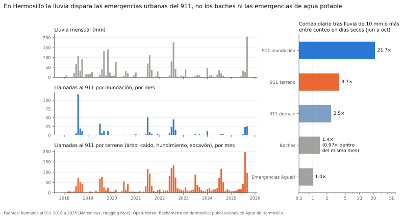

# Lluvia y emergencias urbanas en Hermosillo: hallazgos

Corte: 15 de noviembre de 2026. Cifras de `notebooks/08-exploracion-redefinicion.ipynb`;
figura de `scripts/figura_hallazgo.py`.

- Borrador técnico de los hallazgos de la exploración (notebook 08).
- Entregables finales: reporte ejecutivo en `docs/reporte/reporte.pdf` (notebook 09) y reporte
  técnico en `docs/reporte_tecnico/reporte_tecnico.pdf`.

Pregunta: ¿cuánto aumentan las emergencias urbanas reportadas al 911 en Hermosillo cuando
llueve, qué tipos de incidente responden y en qué colonias se concentran en cada temporada
de lluvias?

## 1. La lluvia multiplica las llamadas al 911 por inundación

Conteo diario medio en los 8 días que siguen a una lluvia de 10 mm o más, contra días sin
lluvia en los 8 días previos, ambos de junio a octubre de 2018 a 2025.

| Serie | Días tras lluvia | Media tras lluvia | Días secos | Media en secos | Razón | Meses con más en días húmedos, control dentro del mes |
|---|---:|---:|---:|---:|---:|---|
| 911 inundación | 167 | 1.41 | 586 | 0.06 | 21.7 | 14 de 26 (2 con menos) |
| 911 terreno | 167 | 3.14 | 586 | 0.86 | 3.7 | 17 de 26 |
| 911 drenaje | 167 | 0.74 | 586 | 0.30 | 2.5 | 17 de 26 |
| Baches | 118 | 28.70 | 343 | 20.15 | 1.4 | 5 de 12 (razón 0.97) |
| Emergencias de Agua de Hermosillo | 122 | 0.47 | 409 | 0.47 | 0.99 | |

- La correlación de Spearman entre la lluvia del día y las llamadas es máxima el mismo día:
  0.30 en inundación y 0.31 en terreno; a los 7 días baja a 0.14 y 0.19.
- Los años más secos tienen menos llamadas por inundación: 2020 (162 mm, 3 llamadas), 2023
  (78 mm, 7) y 2024 (148 mm, 17), contra 2018 (348 mm, 153) y 2022 (327 mm, 90).

## 2. Las llamadas se concentran en julio a septiembre; los baches no

Participación de julio a septiembre en el total anual (25% en una serie sin estacionalidad).

| Serie | Años | Rango |
|---|---|---|
| 911 terreno | 2018 a 2024 | 57% a 74% |
| 911 inundación | 2018, 2019, 2021, 2022, 2023 | 71% a 92% |
| 911 drenaje | 2018 a 2024 | 25% a 47% |
| Baches | 2022 a 2025 | 24% a 27% |
| Emergencias de Agua de Hermosillo | 2021 a 2025 | 24% a 45% |
| Lluvia | 2018 a 2025 | 34% a 92% |

- El salto de julio a agosto en baches (1.5 a 2.4 veces, 2022 a 2026, según
  `docs/cinco_v_datos.md`) no es un pico de lluvia: julio es de los meses con menos reportes
  del año (participaciones mensuales en notebook 08, sección E1).
- Las publicaciones de pipas son un episodio: 28 de 41 en julio y agosto de 2024, después de
  2023 y 2024 con 78 mm y 148 mm de lluvia.
- Las emergencias de Agua de Hermosillo en abril a junio suman 48.5% en 2023 y entre 17% y
  29.5% en 2021, 2022, 2024 y 2025.

## 3. Ubicación: cerca de los cauces en conjunto, sin colonias fijas

Llamadas con colonia de la ciudad identificada por nombre (67% del total), con la distancia
del centroide de la colonia al tramo de cauce más cercano de la Red Hidrográfica 1:50k.

| Medida | Valor |
|---|---|
| Mediana de distancia al cauce, inundación | 357 m (293 llamadas) |
| Mediana de distancia al cauce, terreno | 519 m (1,752 llamadas) |
| Mediana de distancia al cauce, drenaje | 452 m (730 llamadas) |
| % de inundación por cuartil de distancia, del más cercano al más lejano | 11.7, 16.9, 9.8, 7.8 |
| Spearman por colonia entre % de inundación y distancia al cauce | 0.03 (314 colonias) |
| Persistencia entre años de llamadas tras lluvia por colonia (Spearman) | 0.01 a 0.23 |
| Persistencia entre años de todas las llamadas por colonia (Spearman) | 0.36 a 0.51 |
| PCA del perfil mensual de 138 colonias: PC1 | 33% de varianza; cargas julio −0.48, agosto 0.85 |
| Spearman entre PC1 y distancia al cauce | −0.17 |

## 4. Días anómalos

Total diario de llamadas por inundación, terreno y drenaje, 2018 a 2025. Técnicas: Tukey
(k = 3) sobre el residuo contra la mediana móvil de 29 días; IForest, ECOD y LOF sobre conteo,
residuo y día del año (`contamination = 0.01`). Ninguna usa la lluvia.

| Medida | Valor |
|---|---|
| Días con 2 votos o más | 36 |
| En julio a septiembre | 83.3% |
| Con lluvia de 1 mm o más en los 8 días previos | 91.7% |
| Con lluvia de 10 mm o más en los 8 días previos | 36.1% (9.5% de todos los días) |
| Jaccard IForest y ECOD; Tukey con ambos; LOF con el resto | 0.61; 0.33; 0.02 a 0.04 |

- Días con más llamadas: 12 de agosto de 2018 (66 llamadas, 27.2 mm), 16 de julio de 2022
  (61, 12.5 mm), 23 de julio de 2019 (47, 0.1 mm), 12 de octubre de 2018 (46, 52.4 mm).

## 5. Texto

| Fuente | Textos que mencionan lluvia, tormenta, chubasco, aguacero, encharcamiento o inundación |
|---|---|
| Descripciones de baches | 0.5% a 1.5% por mes, sin pico en temporada |
| Publicaciones de Agua de Hermosillo (texto y OCR) | 7.0% en julio y 7.5% en agosto; 2% o menos el resto del año |

- Las publicaciones de Agua de Hermosillo de julio y agosto con esas palabras atribuyen a las
  tormentas apagones que detienen el bombeo, salidas de operación en El Novillo y pipas de
  apoyo.

## Limitaciones

- La lluvia es un modelo en malla (Open-Meteo, combinación por defecto de reanálisis), no una
  estación: 64% de los días anómalos no tienen 10 mm registrados en su ventana.
- El 911 no trae coordenadas; 33% de las llamadas no se ubican en una colonia por nombre.
- `fenomeno_hidrometeorologico` existe solo en 2025 (27 llamadas): cambio de catálogo.
- No hay población por colonia; los conteos por colonia no son tasas.
- La red hidrográfica 1:50k data de 1998 a 2010 y no incluye drenaje pluvial.

## Bibliografía

- Adams, D. K. y Comrie, A. C. (1997). The North American Monsoon. Bulletin of the American
  Meteorological Society, 78(10), 2197-2213. https://doi.org/10.1175/1520-0477(1997)078<2197:TNAM>2.0.CO;2
- Agua de Hermosillo. Publicaciones de la página oficial de Facebook, diciembre de 2020 a
  septiembre de 2026. Snapshot descrito en `data/SNAPSHOT.md`.
- H. Ayuntamiento de Hermosillo. Bachómetro. https://bachometro.hermosillo.gob.mx
- INEGI (2025). Delimitación de colonias y otros asentamientos humanos (DCAH).
  https://www.inegi.org.mx/programas/dcah/
- INEGI. Red Hidrográfica escala 1:50 000, edición 2.0. https://www.inegi.org.mx/temas/hidrografia/
- Li, Z., Zhao, Y., Hu, X., Botta, N., Ionescu, C. y Chen, G. H. (2022). ECOD: Unsupervised
  Outlier Detection Using Empirical Cumulative Distribution Functions. IEEE Transactions on
  Knowledge and Data Engineering. https://doi.org/10.1109/TKDE.2022.3159580
- Liu, F. T., Ting, K. M. y Zhou, Z.-H. (2008). Isolation Forest. IEEE International Conference
  on Data Mining, 413-422. https://doi.org/10.1109/ICDM.2008.17
- Marcelinux (2025). Llamadas 911 por colonia, Hermosillo 2018-2025. Hugging Face, CC-BY-4.0.
  https://huggingface.co/datasets/Marcelinux/llamadas911_colonias_hermosillo_2018_2025
- Muñoz-Sabater, J. et al. (2021). ERA5-Land: a state-of-the-art global reanalysis dataset for
  land applications. Earth System Science Data, 13, 4349-4383. https://doi.org/10.5194/essd-13-4349-2021
  (uno de los reanálisis que combina Open-Meteo; no está confirmado que sea el que usa para este punto).
- Zippenfenig, P. (2023). Open-Meteo.com Weather API. Zenodo. https://doi.org/10.5281/zenodo.7970649
