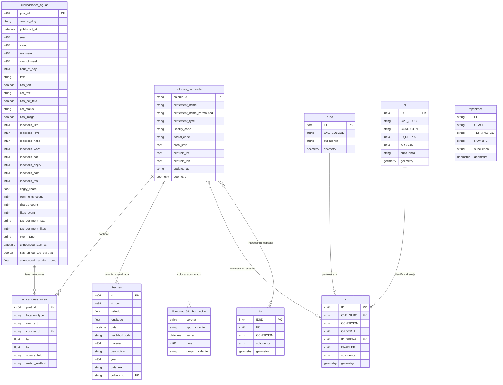

# Esquema de los datos procesados

Diagrama entidad–relación de los datasets de `data/processed/` usados en las
libretas de análisis. Hay una entidad por dataset y, en el caso de
`hidrografia_cd_hermosillo.gpkg`, una por capa (`hl`, `dr`, `ha`, `subc`, `to`).

Las relaciones en **línea continua** (`--`) son llaves reales entre columnas; las
de **línea punteada** (`..`) no son restricciones declaradas: se resuelven en los
jobs o en las libretas (unión por nombre normalizado o unión espacial).

## Entidades y archivos

| Entidad | Archivo | Una fila representa |
|---|---|---|
| `publicaciones_aguah` | `data/processed/aguah/publicaciones_aguah.csv` | Una publicación de Facebook de Agua de Hermosillo |
| `ubicaciones_aviso` | `data/processed/aguah/ubicaciones_aviso.csv` | Una mención de un lugar (colonia o cruce) dentro de una publicación |
| `colonias_hermosillo` | `data/processed/aguah/colonias_hermosillo.gpkg` (y `.csv`) | Un asentamiento del catálogo DCAH/INEGI con su polígono |
| `baches` | `data/processed/bachometro/baches_hermosillo.csv` | Un reporte ciudadano de bache del Bachómetro |
| `llamadas_911_hermosillo` | `data/processed/llamadas_911/llamadas_911_hermosillo.csv` | Una llamada al 911 por incidente relacionado con agua |
| `subc`, `hl`, `dr`, `ha`, `to` | `data/processed/inegi/hidrografia_hermosillo/hidrografia_cd_hermosillo.gpkg` | Capas INEGI 1:50 000: unidad de captación, cauces, puntos de drenaje, cuerpos de agua y topónimos |

## Notas

- **`ubicaciones_aviso` no tiene llave primaria propia**: cada fila es una mención;
  la misma publicación puede mencionar muchas colonias y cruces (`post_id` se repite).
  `colonia_id` es nulo (~2.4%) cuando `match_method` es `unmatched`, y `lat`/`lon`
  solo existen en `cruce_geocodificado`.
- **`baches` ↔ `colonias_hermosillo`** se resuelve espacialmente: el Bachómetro usa
  sus propios IDs de colonia (`neighborhoods`, no empatables a `colonia_id`). La
  variante `baches_hermosillo_colonia_filled.csv` agrega `colonia_id` (within +
  nearest ≤500 m) con su metodología de match (`spatial_match_method`,
  `distance_to_colonia_m`, `contexto_ubicacion`).
- **`llamadas_911.colonia` es texto libre del operador** (incluye `SIN COLONIA` y
  nombres sin catálogo): no es una llave real; las libretas la unen a
  `colonias_hermosillo` por `settlement_name_normalized` con ~70% de emparejamiento.
- **`colonias_hermosillo` ↔ hidrografía** es una relación puramente espacial
  (intersección de polígonos con segmentos `hl`/`ha` en las libretas); no hay
  columna que la declare. `dr` es un solo punto de drenaje por el área urbana.
- En `hl`, `ORDER_1` es el orden de Strahler del segmento (≥4 colector principal,
  -1 sin clasificar) e `ID_DRENA` apunta al punto de drenaje `dr` que recibe el
  segmento.
- Los perfiles completos por columna (nulos, distintos, rango, descripción) están
  en los diccionarios de esta misma carpeta (`<dataset>.csv` /
  `json/diccionario_<dataset>.json`).
